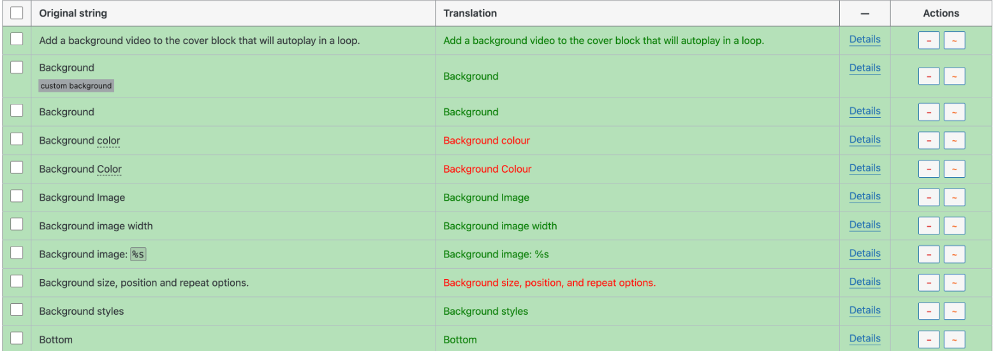

# GlotPress English Variant Utilities

A userscript for translators of English variant locales (en_GB, en_CA, en_AU, en_NZ and so on) on [translate.wordpress.org](https://translate.wordpress.org/).

Most strings in an English variant are identical to the en_US original. This script shows you at a glance which translations match the original and which differ, and lets you submit the untouched strings in bulk, so your time goes on the strings that genuinely need a variation.

## Features

- **Match/differ colouring.** Translations identical to the original are green; those that differ are red. [More about colouring](docs/colouring.md).
- **Bulk "Copy original & save".** Tick rows, press one button, and each original is saved as its translation, just as if you had opened the editor, pressed Copy, then Save. [More about bulk copying](docs/bulk-copy.md).

> [!IMPORTANT]
> Green means the translation hasn't changed from the original, not that it's correct for your locale.

## Getting started

1. Install [Tampermonkey](https://www.tampermonkey.net/) (or another userscript manager), then [open the raw script](https://raw.githubusercontent.com/GaryJones/glotpress-english-variant-utilities/main/glotpress-en_gb.user.js) and confirm the install. Updates arrive automatically; see [Installing and updating](docs/installing.md).
2. On translate.wordpress.org, open a project in your locale and filter to **Untranslated**.
3. Press **Select untranslated**, untick the strings that need a real variation (you'll translate those by hand), then press **Copy original & save**.

## Documentation

The [docs](docs/README.md) cover each feature in detail, how the script talks to GlotPress, and how to contribute.

## Licence

[MIT](LICENSE)
