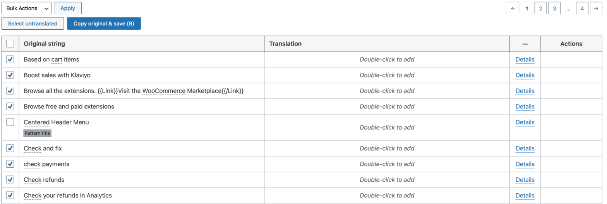

# Bulk copy

If you can bulk edit a translation set (you'll see checkboxes on each row), the script adds a toolbar above the table:

- **Select untranslated** ticks every untranslated row on the page and leaves other rows as they are. GlotPress's own header checkbox, and shift-click to tick a range, also work.
- **Copy original & save (n)** saves the en_US original as the translation of every ticked row. The count shows how many rows are ticked.
- **Stop** appears during a run. It lets the requests already sent finish, then halts the rest.

## Recommended workflow

1. Open the set and filter to **Untranslated**.
2. Press **Select untranslated** (or tick the header checkbox).
3. Untick the strings that need a genuine variation for your locale, such as "Centered Header Menu" in the screenshot above. Translate those by hand.
4. Press **Copy original & save**.

Your permissions apply exactly as they do in the editor. If you can approve translations, the copies are saved as current; otherwise they wait for review.

## What each row shows afterwards

| Outcome | What you see |
| --- | --- |
| Saved | The row updates in place, briefly flashes green, and its translation is [coloured](colouring.md). |
| Already existed | An amber outline, and the row is unticked. GlotPress already had an identical translation. |
| Failed | A red outline. Hover the row for the error; it's also logged to the browser console. The row stays ticked, so you can try again. |

Rows you left unticked aren't touched, so the strings you set aside for a hand translation are still untranslated afterwards.

The status next to the buttons shows progress while the run is going, then a summary.

## Large batches

Up to 100 rows, every row is saved individually, four at a time, with the same request the editor's Save button sends. That's the normal path.

Above 100 rows, the script sends the whole batch in a single PO file import instead, then reloads the page. That path exists, but the threshold is set high on purpose: imported translations aren't attributed to you. See [How it works](how-it-works.md#the-import-path) for the details.
