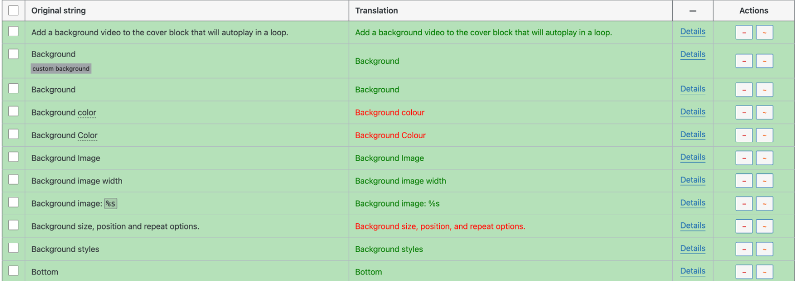

# Colouring

On any translation set page, the script compares each translation with its original and colours the translation:

- **Green** ("Same as original" on hover): the translation is identical to the en_US original.
- **Red** ("Differs from original" on hover): the translation differs from the original.

Untranslated rows are left alone.

> [!IMPORTANT]
> Green does not mean the translation is right for your locale, only that it hasn't changed from the original. A string that should read "colour" but was copied as "color" is green.

## What the comparison ignores

GlotPress adds some things to the table that aren't part of the string. The script hides them while it compares, then puts them back:

- **Context and priority tags** under the original, such as "Pattern title" or "Priority: high".
- **Whitespace glyphs**: ↵ for a newline and → for a tab.

Everything that is part of the string counts, including:

- Arrows typed into the string itself, such as "Settings → Connectors".
- Leading, trailing and repeated spaces, which GlotPress draws with a box round them.
- The "Singular" and "Plural" labels on plural strings, which appear in both cells, so the two forms are compared together.

A tab where the original has a →, or a missing trailing space, shows red. That's often the point: such differences are easy to miss by eye.

## When colours update

Colours are applied when the page loads, and again whenever GlotPress replaces a row, for example after you save in the editor or the script saves a row in a [bulk copy](bulk-copy.md).
